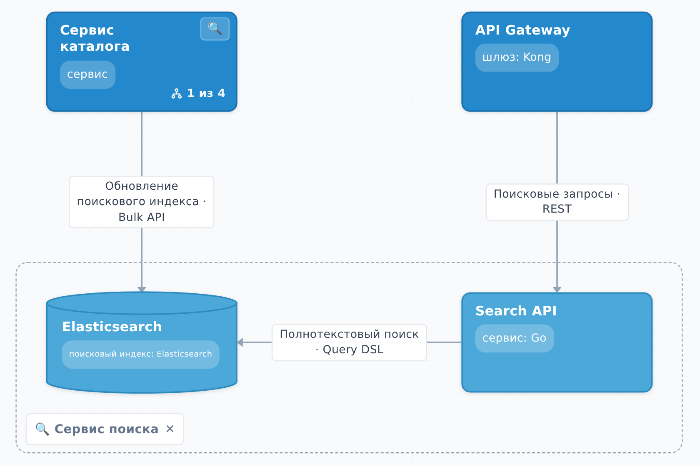

## Дерево объектов {#tree}

Слева от схемы — дерево объектов проекта. Оно показывает всю иерархию целиком, независимо от того, какой уровень открыт на холсте.

- Клик по объекту в дереве открывает его уровень на схеме и выделяет объект.
- Стрелка слева от имени раскрывает ветку дерева, не меняя уровень на схеме.
- Значок перед именем показывает форму объекта: сервис, база данных, брокер сообщений или человек.
- Объект, у которого есть части, называется **контейнером**: его можно открыть как уровень или раскрыть прямо на месте.

### Раскрытие на месте

На свёрнутом контейнере есть лупа. Нажмите её — части контейнера появятся внутри его рамки, а связи протянутся к ним. Так можно рассматривать систему на столько уровней, на сколько нужно, не покидая схему. Повторное нажатие сворачивает контейнер обратно.

### Переход внутрь

Двойной клик по контейнеру открывает его уровень: на холсте остаются его части и те соседи, с которыми они связаны. Вернуться наверх можно по хлебным крошкам над схемой.
