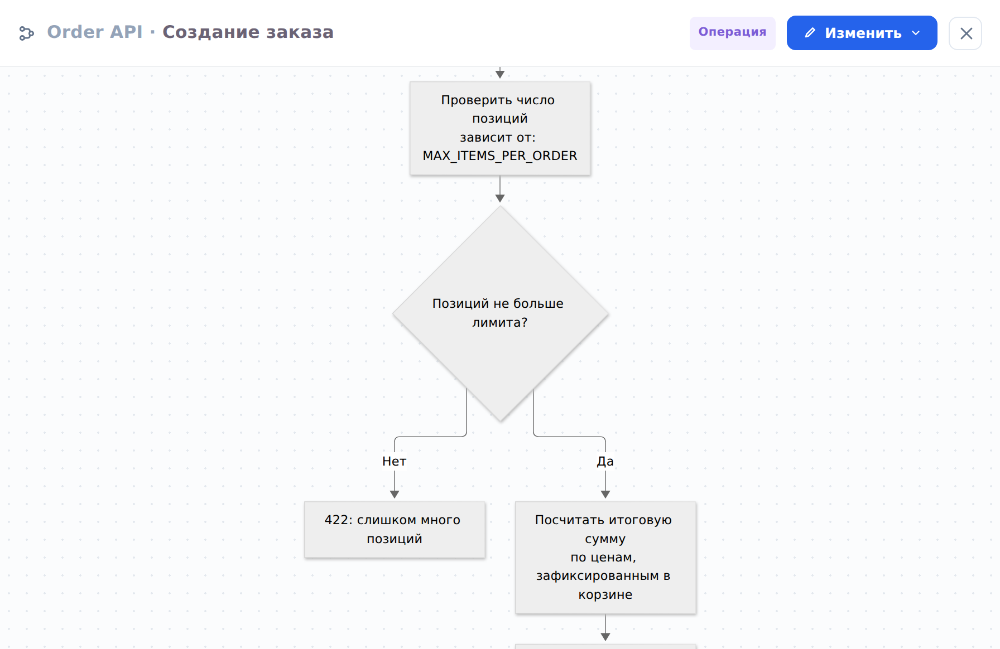

У каждого объекта в проекте есть своя страница. Открыть её можно двойным кликом по объекту без частей, из дерева объектов или из результатов поиска.

## Свойства

В шапке страницы — имя объекта, его роль (например, «сервис» или «брокер»), технология и статус: **существует**, **планируется** или **выводится**. Статус виден и на схеме: планируемые объекты рисуются пунктиром, выводимые — приглушённо.

## Схема

Раздел «Схема» показывает объект в его окружении: соседей по уровню, с которыми он связан, и связи между ними. Это та же схема, что на уровне родителя, обрезанная до нужного. Её можно раскрывать и двигать так же, как описано в разделе [Дерево объектов](navigation.md#tree).

## Логика

«Логика» — именованные схемы того, что объект делает: операции и фоновые воркеры. Схема логики — диаграмма Mermaid; в ней могут быть пометки, которые связывают шаги с таблицами базы, каналами брокера и параметрами конфигурации.

## OpenAPI

Если у объекта есть спецификация OpenAPI, она показывается в отдельном разделе — списком операций и в полном виде. Операции из спецификации можно привязать к схемам логики.

## Факты {#facts}

Внизу страницы собраны факты, снятые с кода: структура базы данных, каналы брокера и параметры конфигурации. Их заполняет архитектор — вручную или импортом, см. [Факты из кода](../architect/import.md#facts) в руководстве архитектора.

::: note
Факты описывают код, а не окружения: у параметра конфигурации хранится значение по умолчанию из кода, а не значения продакшена или стенда.
:::
